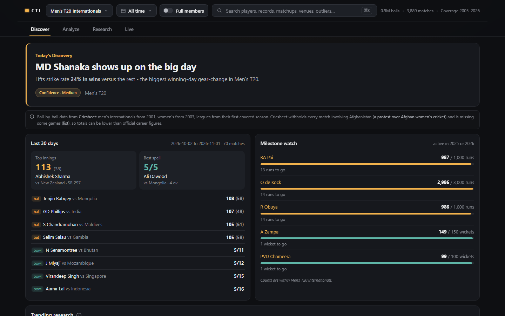

# Cricket Intelligence Lab: Ball-by-Ball Analysis of 49 Competitions

How good is a player really, once you account for who they played, when and in which phase of the innings? This project answers that from the ball-by-ball record: 23,000+ matches and 11.7 million deliveries across 49 men's and women's competitions (Tests, ODIs, T20Is and the major T20 leagues). Every delivery from [Cricsheet](https://cricsheet.org)'s open data is loaded into SQLite, cleaned, and turned into per-competition rankings, percentiles, phase and situation splits, batter-versus-bowler matchups, era-adjusted indices and win-probability models. A browser dashboard is the way to explore the results.

Built with Python, SQLite, NumPy and a plain HTML/JavaScript dashboard, rebuilt weekly by GitHub Actions from Cricsheet's open data.

> **What it's for:** look up any player and see where they rank within their competition and why, compare up to four side by side, find which bowlers have the best record against a given batter, and see how scoring, the toss and chasing have changed over time.

**Live demo:** [halcyonvector.github.io/Cricket-Intelligence-Lab](https://halcyonvector.github.io/Cricket-Intelligence-Lab/)



---

## Disclaimer

This is a personal learning project, not an official statistics source. Figures come only from matches in Cricsheet's ball-by-ball archive, so career totals can be lower than official records (see Honest Limitations). Win probabilities are simple statistical models for exploration, not betting or selection advice. Player photos come from Cricbuzz's CDN (display only) and Wikimedia Commons (credited per file).

---

## Findings

From the data, using complete seasons up to 2025:

- **IPL scoring jumped in 2023.** The average first-innings total was **162.6** from 2008 to 2022 and **187.8** from 2023 to 2025. Totals of 200 or more went from **10%** of first innings (96 of 946) to **38%** (82 of 215). The jump lines up with the Impact Player rule, which lets teams bat deeper, and the run rate has kept rising since (8.05 an over in 2021, 9.63 in 2025).
- **Chasing stopped being the safe choice in the IPL.** Chasing sides won **55.3%** of decided matches before 2023 (515 of 932) and **49.5%** since (106 of 214). Bigger first-innings totals took away most of the old advantage.
- **The toss barely matters.** Across every decided match in the data, the toss winner won **50.7%** of T20s (13,529 matches), **49.7%** of ODIs (4,783) and **52.2%** of Tests (2,056).
- **Most men's T20Is are no longer between the top teams.** Before 2019, **59%** of men's T20Is were between two ICC full members (499 of 852). After the ICC gave every member T20I status, that fell to **22%** (558 of 2,499). Raw leaderboards fill up with figures built against associate nations, which is why the dashboard has a "full members only" switch that rebuilds every view from full-member matches only.
- **A small counting rule moved career totals.** The first version counted a batter's balls the way a bowler's are counted, leaving out no-balls. Batters do get the runs and the ball off a no-ball, so their totals were too low. With that fixed, Alastair Cook's Test runs in the data are **12,472**, matching his official total, and a 513,000-check audit now guards every weekly build.
- **Venue splits needed a competition filter.** A player's "by venue" table first mixed every competition they'd played, which made Rohit Sharma's T20I record at Wankhede include his IPL games there. Venue splits are now per competition.

---

## Features

### Players

- **Batter and bowler profiles:** percentiles within the competition, archetypes, phase splits (powerplay, middle, death), situation splits, by-venue records and the most similar players.
- **Form by season:** runs, average or strike rate (wickets, economy or strike rate for bowlers) per season, for one competition or all of them.
- **Where they stand:** each key stat drawn against every rated player in the competition, so "96th percentile" shows how far ahead that really is.
- **Archetypes:** batters are tagged as one of five scoring styles; bowlers as Strike bowler, Holder, Powerplay specialist, Death specialist or Workhorse.
- **Also played in:** every other competition the player appears in, one click away.

### Analysis

- **Time window:** all time, the last two seasons or since 2015. Leaderboards, records, percentiles, archetypes and profiles are recomputed for the window.
- **Full members only** (international competitions): every view switches to a version of the data built only from matches between the 12 ICC full members.
- **Matchups:** any batter against any bowler with at least 12 balls between them (18 in Tests): runs, dismissals, strike rate and a dominance score.
- **Who should bowl to...:** pick a batter and a phase and get the bowlers with the best record against them.
- **Records, outliers, a research scatter plot of any stat against another, a similarity network and a four-player comparison.**

### Teams, grounds and matches

- **Team pages:** win % by year, head-to-head against every opponent, top run-scorers and wicket-takers.
- **Venue pages:** first-innings average by year, toss effect, top performers and recent matches.
- **Match pages:** the latest 40 matches per competition with run progression, runs per over, batting and bowling summaries and a win-probability line.
- **Live scores:** live scores, fixtures and ball-by-ball commentary from Cricbuzz, with a live win chance on T20 and ODI scorecards.

### Exploring the data

- Search across all competitions (Ctrl/Cmd-K), a shareable URL for every view, and a "?" explanation next to each advanced metric.
- Notes on every page that explain what Cricsheet's data doesn't cover.
- Works offline, installs as an app and has a bottom tab bar on phones.

---

## Data Source

| Source | What it provides | Licence |
|--------|------------------|---------|
| [Cricsheet](https://cricsheet.org) match files (`all_json.zip`) | Every delivery of every covered match: batter, bowler, runs, extras, wickets, teams, venue, toss and result | ODbL |
| [Cricsheet people register](https://cricsheet.org/register/) | Player IDs mapped to ESPNcricinfo IDs, for countries and links | ODbL |
| [Wikidata](https://www.wikidata.org) and English Wikipedia | Freely licensed player photos, matched on ESPNcricinfo ID | Per file (Wikimedia Commons) |
| ICC rankings pages | Current men's and women's player and team rankings | Display only |
| Cricbuzz | Live scores, fixtures, commentary and headshots | Display only |

### Cleaning and method

- **Loading:** each match file is streamed into SQLite as one row per delivery, with the phase (powerplay, middle, death), the chase state (target, runs required, balls left) and the result attached to each ball.
- **Batting** counts every delivery except wides, so runs and balls off no-balls count. **Bowling balls** exclude wides and no-balls.
- **Qualifiers:** counting stats include everyone. Rate stats, percentiles and archetypes need a format-aware minimum (60 balls in T20, 150/120 in ODIs, 300 in Tests), and outlier flags need three times that.
- **Era-adjusted index:** a batter's runs against what an average batter would have scored on the same balls in the same seasons (100 = par).
- **Dominance:** a batter-versus-bowler score from 0 to 1 combining scoring rate and dismissal rate, shrunk toward 0.5 for small samples.
- **Win probability:** two logistic models per format and gender (first innings: runs, balls, wickets; chase: runs needed, balls left, wickets), fitted on every end-of-over state. Held-out Brier scores are about 0.21 (first innings) and 0.12 (chase).
- **Time window:** rebuilt in the browser from per-season totals. Advanced metrics and similarity stay all-time.

---

## Tech Stack

| Layer | Technology | Details |
|-------|-----------|---------|
| **Ingest** | Python, orjson | Streams Cricsheet's zip into SQLite one delivery at a time |
| **Storage** | SQLite | About 11.7 million delivery rows plus match and player tables |
| **Analytics** | Python, NumPy | Percentiles, splits, matchups, similarity, era indices, win-probability models |
| **Dashboard** | Plain HTML, CSS and JavaScript | No framework or build step; hand-drawn SVG charts |
| **Live scores** | Python serverless function | `serve.py`'s API, run on Vercel |
| **Automation** | GitHub Actions | Weekly rebuild, data audit, tests and deploy |
| **Hosting** | GitHub Pages | Static site; data published as a GitHub release |

---

## Prerequisites

- **Python 3.11+:** [download here](https://www.python.org/downloads/)
- To rebuild the data: `pip install orjson numpy` and about 2 GB of free disk space.

No API keys or accounts are needed.

---

## Quick Start

```bash
git clone https://github.com/HalcyonVector/Cricket-Intelligence-Lab.git
cd Cricket-Intelligence-Lab
python scripts/fetch_data.py   # downloads the latest built data (about 25 MB)
python serve.py                # http://127.0.0.1:5000
```

The built data isn't committed to git. The weekly build publishes it as the [`data-latest` release](https://github.com/HalcyonVector/Cricket-Intelligence-Lab/releases/tag/data-latest) and `fetch_data.py` pulls it into `web/dashboard/`. You can also open `web/dashboard/index.html` directly; everything except live scores works.

### Rebuild the data yourself

```bash
pip install orjson numpy
# download all_json.zip from https://cricsheet.org/downloads/ into the project root
python scripts/build_all.py --zip all_json.zip
```

This loads every match into SQLite (`cil.db`), recomputes all the analysis, writes the data files and runs the integrity check.

### Other scripts

| Task | Command |
|------|---------|
| Run locally with live scores | `python serve.py` (set `PORT` to change from 5000) |
| ICC rankings | `python scripts/fetch_icc_rankings.py` (needs Playwright) |
| Player countries and links | `python scripts/enrich_players_cricinfo.py` |
| Player photos | `python scripts/build_photo_wikidata.py` (after the step above) |

If the dashboard says "No data found", run `python scripts/fetch_data.py` first.

---

## Project Structure

```
Cricket-Intelligence-Lab/
├── serve.py                       # Local server: static site + live-scores API
├── requirements.txt               # Runtime deps for serve.py and the Vercel API
├── packages/
│   ├── etl/cil_etl/               # Cricsheet zip -> SQLite (ingest_zip.py, parse.py, store.py)
│   └── analytics/cil_analytics/
│       ├── pipeline.py            # Per-competition analysis -> data files, matchups, careers, players index
│       ├── extras.py              # Per-season stats, venue/team/match detail, latest 30 days
│       └── winprob.py             # Win-probability models (T20/ODI, men/women)
├── scripts/
│   ├── build_all.py               # One command: zip -> SQLite -> data files -> verify
│   ├── verify_build.py            # Post-build integrity check
│   ├── fetch_data.py              # Download the latest built data
│   ├── fetch_icc_rankings.py      # ICC rankings (Playwright)
│   ├── enrich_players_cricinfo.py # Countries + ESPNcricinfo links -> playermeta.js
│   ├── build_photo_wikidata.py    # Wikimedia Commons photos -> playermeta.js
│   └── build_player_images.py, build_photo_byid.py   # Cricbuzz photo maps
├── web/
│   ├── landing.html, og.png, favicon.svg, shots/
│   └── dashboard/
│       ├── index.html             # The dashboard
│       ├── features.js            # Time window, Bowl to, venue/team/match pages, search, glossary
│       ├── sw.js, manifest.webmanifest, config.js
│       ├── playermeta.js, playerimg.js
│       └── (generated, not in git) index.js, rankings.js, players.js, winprob.js,
│           cohorts/<key>.js, cohorts/<key>__fm.js (full members), d/, matchups/, x/, careers/
├── api/, vercel.json, vercel/     # Live-scores API on Vercel (wraps serve.py)
├── tests/                         # Unit + pipeline tests, data_consistency.py, browser/smoke.py
└── docs/                          # Screenshots, ADR and the original design spec
```

---

## Architecture

```
all_json.zip ─► build_all.py ─► cil.db (SQLite) ─► pipeline.py + extras.py + winprob.py
   ─► data files per competition (+ full-members versions) ─► verify_build.py ─► data_consistency.py
   ─► data-latest release ─► GitHub Pages ─► dashboard in the browser
                                                   ▲
                    Cricbuzz ─► Vercel function ───┘ (live scores only)
```

| Piece | Where | Notes |
|-------|-------|-------|
| Dashboard and landing page | GitHub Pages | Static files on a CDN |
| Weekly data build | GitHub Actions (`site.yml`) | Mondays 05:00 UTC: Cricsheet, data files, ICC rankings, audit, release, deploy |
| Code deploys | GitHub Actions (`site.yml`) | A push touching `web/` redeploys with the latest data, without a rebuild |
| Live scores API | Vercel (`api/index.py`) | Runs `serve.py`'s `/api/*`, CDN-cached (live 30 s, schedule 10 min) |

The heavy work happens once a week in the build. Each competition gets a small core file loaded on first view, plus profile detail, matchups and extras files loaded only when a page needs them. The browser only re-ranks for a time window and does the win-probability maths.

To host your own copy: set **Settings > Pages > Source** to GitHub Actions, run **Build data & deploy site** with "Rebuild data" ticked, then (optionally) import the repo into Vercel and set the repository variable `LIVE_API_URL` to its URL.

---

## Testing and Validation

```bash
pip install pytest numpy orjson && python -m pytest -q tests
python tests/data_consistency.py
pip install playwright && python -m playwright install chromium && python tests/browser/smoke.py
```

- **Pipeline tests:** run a synthetic Cricsheet zip through ingest and the full build, then check every output file, including the full-members versions.
- **Data audit (about 513,000 checks across 49 competitions and their full-members versions):** season totals add up to career totals, phase balls never exceed total balls, matchup players exist, record holders match the leaderboards, venue runs never exceed competition runs, and full-members figures never exceed all-match figures. The weekly build won't publish if any check fails.
- **Browser test:** opens 22 views in headless Chromium against the real data and fails on any JavaScript error or missing content.

All three run in CI on every push.

---

## Honest Limitations

- **Coverage has gaps.** Ball-by-ball data starts in 2001 for men's internationals and 2003 for women's, and leagues from their first covered season. Some matches are [missing from Cricsheet's archive](https://cricsheet.org/missing/), and domestic competitions it doesn't cover (such as the Ranji Trophy) aren't here at all.
- **No Afghanistan matches.** Cricsheet withholds every match involving Afghanistan ([their explanation](https://cricsheet.org/article/explanation-for-withholding-of-afghanistani-matches/)), so Afghanistan's players and results are missing and their opponents' totals are lower.
- **Correlation, not cause.** The findings above, like the 2023 jump in IPL totals, line up with rule changes but the data can't separate the rule from other changes such as pitches or batting depth.
- **The win-probability models don't know the teams,** the pitch, the weather or rain rules. They only see the score, balls and wickets.
- **Small samples.** Matchups need only 12 balls (18 in Tests). Dominance is shrunk toward neutral to help, but short histories are still noisy.
- **Photos are incomplete.** Players without a Cricbuzz headshot or a freely licensed Wikipedia photo show initials.
- **Live scores depend on Cricbuzz's pages,** which can change or rate-limit without notice.

---

## Suggested Future Features

- **Trends page:** run rate, boundary % and dot-ball % by season for every competition.
- **Rolling form chart** on player profiles (last 10 innings).
- **Score projection** next to the win probability on live and match pages.
- **Team-aware win probability** that uses team strength, not just the score.
- **Custom stat definitions** built in the browser.

---

## Author

**Sagnik**

GitHub: [@HalcyonVector](https://github.com/HalcyonVector)

---

## License

**Data:** [Cricsheet](https://cricsheet.org), Open Data Commons Open Database License (ODbL). If you reuse the data, attribute Cricsheet and share alike.

**Code:** no license specified yet; contact the author for usage rights.
